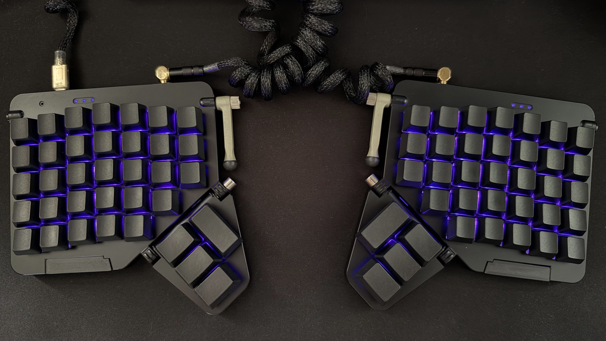

<div align="center">

# moonlander-rmk-1

Firmware for the **ZSA Moonlander MK I** keyboard, built using [RMK] and the [Embassy] async embedded Rust ecosystem.



</div>

## 🛠️ Features

The firmware provides a modular set of Cargo features allowing you to customize your build:

- **`indicators`**: Enables support for indicator LEDs.
- **`locks`**: Automatically enables `indicators` and enables support for lock status (i.e., Num Lock, Caps Lock).
- **`rgb`**: Enables underglow and lighting support based on `rmk-palettefx`.
- **`halfmoon`**: Configures the firmware to discard the right side of the keyboard.
- **`debounce_fast`**: Uses high-frequency key debouncing logic for minimal latency.
- **`defmt`**: Enables structured, low-overhead logging and debugging across the Embassy ecosystem.

### TBI

- Audio support.

## 🚀 Building & Flashing

> **⚠️ WARNING — HARDWARE REVISION SELECTION**
>
> You **must** select the correct hardware revision (`rev-a` or `rev-b`) matching your Moonlander board.
> Flashing the wrong revision will cause the firmware to malfunction. In particular, flashing a `rev-a` binary
> onto a **Revision B** board can misalign the vector table and permanently **brick the device**.
> Always verify your hardware revision before compiling and flashing.

### 🐳 Via Docker (Recommended)

#### Usage

With the keyboard connected in DFU mode, run `flash.sh` from the repository root.

The script builds the Docker image, compiles the firmware, converts the ELF executable to a binary image,
and flashes the device using `dfu-util`.

```bash
./flash.sh --revision rev-a --profile release

```

For a Revision B board:

```bash
./flash.sh --revision rev-b --profile release

```

#### Options

| Argument | Description |
| --- | --- |
| `--revision` | **Required.** Hardware revision: `rev-a` or `rev-b`. |
| `--profile` | Cargo build profile (e.g., `release`). Defaults to `dev`. |
| `--features` | Comma-separated Cargo features to enable. |
| `--no-default-features` | Disables the default Cargo features. |

#### Examples

Build and flash Revision B with RGB support:

```bash
./flash.sh --revision rev-b --profile release --features rgb

```

Build and flash Revision B without default features:

```bash
./flash.sh --revision rev-b --profile release --no-default-features

```

Combine custom features and disable defaults:

```bash
./flash.sh --revision rev-b \
    --profile release \
    --features rgb,halfmoon \
    --no-default-features

```

The hardware revision is passed to the build script through the `REVISION` environment variable.

It is independent of Cargo features and determines the firmware memory layout and flashing address.

### 💻 Local

To build and flash without Docker, install the following dependencies on your host:

* **Rust toolchain:** stable Rust, managed with `rustup`.
* **Rust target:** `thumbv7em-none-eabihf`, configured in `.cargo/config.toml` and installed through `rustup`.
* **Build tools:** `build-essential`, `pkg-config`, and any additional native dependencies required by the project.
* **ARM GNU toolchain:** `gcc-arm-none-eabi` and `binutils-arm-none-eabi` (provides `arm-none-eabi-objcopy`).
* **DFU utilities:** `dfu-util`.
* **Additional Rust tools:** `flip-link`, if required by the project's linker configuration.

#### Examples

Set the hardware revision through the `REVISION` environment variable when building:

```bash
REVISION=rev-a cargo build --release

```

For Revision B:

```bash
REVISION=rev-b cargo build --release

```

To enable custom features:

```bash
REVISION=rev-b cargo build --release --features rgb

```

To disable default features:

```bash
REVISION=rev-b cargo build --release --no-default-features

```

To flash locally, convert the generated ELF executable to a binary image and use `dfu-util` with the appropriate flash address:

| Revision | Flash address |
| --- | --- |
| Revision A | `0x08000000` |
| Revision B | `0x08002000` |

> Revision B reserves the first **8 KiB** of flash for its bootloader.

## 🎨 Customization

This firmware is designed to be customized. Feel free to fork the repository and make it your own.

To customize your keyboard layout and behavior, navigate to `src/keyboard/keymaps.rs`. There, you can modify
the existing keymaps and layers, add new ones, or tailor the entire layout to your personal workflow and preferences.

You can also tweak some internals parameters like the `debounce_time` at `keyboard.toml`.

And customization doesn't stop there. You can also modify the RGB system, create your own lighting animations, and customize
virtually any part of the firmware.

> Currently, the firmware supports all palettes and animations featured in this [gallery].

**It's your keyboard, your firmware, your rules 🦀 !**

## 📜 License

Licensed under either of Apache License 2.0 or MIT at your option.

> *This project is not affiliated with or endorsed by ZSA Technology Labs, Inc.*

[RMK]: https://github.com/rmk-rs/rmk
[Embassy]: https://github.com/embassy-rs/embassy
[gallery]: https://getreuer.info/posts/keyboards/palettefx/index.html#gallery
